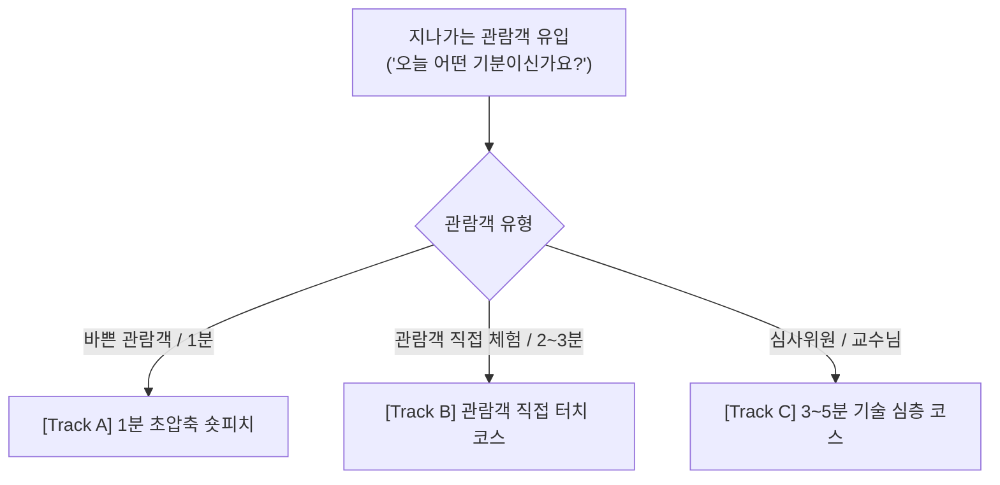

# 🎪 안단테(Andante) 부스(Booth) 현장 시연 시나리오 & 운영 가이드

> **"지나가는 관람객의 발걸음을 멈추고, 1~2분 만에 직접 감동을 체감시키는 현장 밀착형 부스 시연 가이드"**  
> 졸작전, 캡스톤 데모데이, 기술 엑스포 등 **소음이 있고 관람객이 오가는 부스 환경**에 최적화된 시연 대본 및 운영 매뉴얼입니다.

---

## 🧭 1. 부스 운영 세팅 가이드 (추천 하드웨어 구성)

```
[ 메인 데스크 구성도 ]
┌───────────────────────────┐      ┌───────────────────────────┐
│     [PC / 대형 모니터]     │      │   [태블릿 or 스마트폰]    │
│  - 1440px 전체화면 웹     │      │  - ngrok QR 접속 모바일 뷰│
│  - 헤드폰 or 지향성 스피커│      │  - 관람객이 직접 터치 체험│
└───────────────────────────┘      └───────────────────────────┘
```

1. **PC / 모니터**:
   - `http://localhost:3000` 접속, F11 전체화면.
   - 평상시 대기 화면: **'공유 갤러리(`board.html`)'** 또는 **'결과 화면 힐링 모드'**를 띄워두어 지나가는 사람들의 시선을 사로잡음.
2. **모바일 / 태블릿 (관람객 직접 터치용)**:
   - ngrok 주소(`https://contented-tricycle-luster.ngrok-free.dev`) 접속 화면 준비.
   - 메인 데스크 앞에 **QR 코드 안내판** 비치 ("스마트폰으로 내 마음에 맞는 음악과 명화를 받아보세요").
3. **음향 장비**:
   - 부스 환경이 시끄러우므로 **헤드폰 1개 비치** 강력 추천! ("헤드폰을 쓰시면 AI가 골라준 맞춤 힐링 연주곡이 흐릅니다").

---

## ⏱️ 2. 관람객 유형별 3가지 시연 트랙



---

### [Track A] 1분 초압축 숏피치 (바쁜 관람객 & 가벼운 방문객)
> **목표**: 60초 안에 핵심 기능(감정 진단 ➔ 명화·시·음악 생성)을 보여주고 깊은 인상을 남김.

- **[0~10초] 후킹 (발걸음 멈추기)**:  
  > 🎙️ *"안녕하세요! 혹시 오늘 하루 어떠셨나요? 1분 만에 지친 마음에 맞는 명화와 음악을 처방해 드리는 AI 감성 일기 안단테입니다."*

- **[10~30초] 빠른 조작 시연**:  
  - 시연자가 마우스로 능숙하게 클릭:
    - 감정 카드 **[지친 하루 & 쉼의 필요]** ➔ 세부 상황 **[끝없는 과제/업무에 치임]** 클릭
    - "이처럼 감정을 누르면 배경 테마 색상이 심리적 안정감을 주는 파스텔톤으로 즉시 반응합니다."
    - 사연 한 줄 입력 후 즉시 [그림과 시 받기] 클릭.

- **[30~50초] 결과 임팩트 전달**:  
  - "보시는 것처럼 나의 사연을 은유적으로 위로하는 **자작시**, 16:9 와이드 화폭의 **AI 명화 캔버스**, 그리고 상황에 딱 맞춘 **순수 연주 힐링 BGM**이 동시에 매칭됩니다."
  - 음악 플레이어의 태그 가리키기: **`#끝없는 과제/업무에 치임` `#휴식` `#70 BPM`**  
  - "오디오북이나 시끄러운 가사 없이 마음에 쉼을 주는 악기 연주곡만 큐레이션됩니다."

- **[50~60초] 마무리**:  
  > 🎙️ *"QR 코드로 휴대폰에서 바로 체험해 보실 수 있으니 편하게 둘러보세요!"*

---

### [Track B] 2~3분 관람객 직접 터치 코스 (체험형 관람객)
> **목표**: 관람객이 직접 버튼을 누르고 사연을 쓰게 하여 감성적 몰입과 바이럴을 유도.

- **[Step 1] 관람객에게 마우스 or 태블릿 넘기기**:  
  > 🎙️ *"오늘 마음에 가장 와닿는 감정 카드를 하나 골라보시겠어요?"*  
  - 관람객이 6개 감정 중 하나 선택 (예: `반짝이는 영감 & 활력` 또는 `복잡한 생각 & 갈등`)
  - 8개 세부 생활 상황 중 본인 상황 클릭 유도.

- **[Step 2] 배터리 조절 & 한 줄 사연 쓰기**:  
  > 🎙️ *"지금 내 마음의 배터리는 몇 % 정도 남아있나요? 배터리를 드래그하고, 오늘 있었던 일이나 떠오르는 생각을 편하게 한 문장만 적어주세요."*
  - 관람객이 배터리 조절 후 타이핑.

- **[Step 3] AI 생성 대기 중 호흡 인터랙션**:  
  - 로딩 애니메이션 진행 중:
  > 🎙️ *"화면의 동심원을 보시면서 천천히 숨을 들이쉬고 내쉬어 보세요. AI가 방금 적어주신 마음에 어울리는 시와 그림, 그리고 어울리는 템포의 음악을 조율하고 있습니다."*

- **[Step 4] 결과 화면 감상 & 헤드폰 씌워주기**:  
  - 헤드폰을 건네며:  
  > 🎙️ *"헤드폰을 써보시면 작성해주신 기분에 맞춰 큐레이션된 음악이 흐릅니다. `#긴장 완화`처럼 지금 상황에 꼭 필요한 맞춤 태그가 부여된 것을 보실 수 있습니다."*
  - **[힐링 모드 시작]** 버튼을 눌러 전체화면 몰입 뷰를 5초간 체험시켜 주기.

- **[Step 5] 갤러리 공유 체험**:  
  - "이 작품을 하단의 **[갤러리 공유]** 버튼을 눌러 익명 갤러리에 걸어두실 수 있습니다."
  - 등록 후 상단 `공유 갤러리` 탭으로 이동하여 관람객 본인의 카드가 실시간으로 올라간 것을 확인시켜 줌.

---

### [Track C] 3~5분 심사위원 / 교수님 기술 심층 코스
> **목표**: UI 감성뿐만 아니라 백엔드 아키텍처, 안정성, 예외 처리, 비즈니스 가치 증명.

- **[1단계] 기획 의도 및 멀티모달 아키텍처 (1분)**:  
  > 🎙️ *"안단테는 텍스트 위주의 단순 챗봇을 탈피하여, '시(문학) + 명화(시각) + 연주곡(청각)'이 유기적으로 결합된 멀티모달 멘탈케어 플랫폼입니다. 프론트엔드는 글래스모피즘 에디토리얼 디자인을 적용하였고, 백엔드는 Node.js BFF 패턴과 Oracle Cloud DB, Google Gemini 및 Jamendo 음악 API 파이프라인으로 구성되어 있습니다."*

- **[2단계] 음악 큐레이션 엔진 & 웜업(Warmup) 기술 강조 (1.5분)**:  
  - "힐링 서비스에서 음악 끊김이나 딜레이는 치명적입니다. 따라서 저희는 다음과 같은 3중 기술 설계를 적용했습니다:  
    1. **Jamendo 연주곡 전용 필터링**: API 수준에서 `vocalinstrumental=instrumental`을 강제하고, 13가지 음성 키워드(오디오북, 낭독 등)를 2차 정규식으로 차단하여 순수 힐링 BGM만 보장합니다.  
    2. **비동기 웜업(Warmup) 사전 캐싱**: 서버 구동 시 48개 상황별 트랙을 사전 캐싱하여, 사용자가 요청할 때 0.1초 만에 지연 없이 음악이 시작됩니다.  
    3. **블랙리스트 파일 기반 무중단 차단**: `blocked_tracks.json` 설정을 통해 문제 음원은 서버 코드 재배포 없이 즉각 격리됩니다."

- **[3단계] 서재형 일기장 & 안정적 예외 처리 시연 (1분)**:  
  - 상단 메뉴의 **[일기장]** 클릭 ➔ 양장본 책장 서가 화면 시연.
  - LP 플레이어 조작 시연.
  - "만약 음원이 삭제되었거나 차단된 경우에도 서비스가 중단되지 않고 '지금은 재생할 수 없어요'라는 안전한 안내 UI로 처리되는 Fallback 구조를 구현했습니다."

- **[4단계] 보안 표준 준수 설명 (30초)**:  
  - "회원가입과 로그인에는 bcrypt 비밀번호 단방향 암호화, 8자리 이상 복합 규칙, 실시간 아이디 중복 체크, 그리고 존재 여부를 분리 노출하지 않는 보안 표준 메시지를 적용하여 안전성을 확보했습니다."

---

## 💬 3. 부스 관람객 유치(후킹) 원라이너 멘트 모음

지나가는 관람객의 호기심을 자극할 때 상황에 맞게 골라 쓰세요:

1. **지친 표정의 관람객**:  
   👉 *"오늘 과제나 발표 때문에 지치지 않으셨나요? 30초 만에 마음을 달래주는 음악과 명화를 처방해 드립니다!"*
2. **친구/연인과 함께 온 관람객**:  
   👉 *"두 분 오늘 기분 어떠세요? 서로의 기분을 명화와 자작시로 만들어 공유해 보세요!"*
3. **교수님 / 평가위원 등장 시**:  
   👉 *"교수님(심사위원님), 멀티모달 AI와 음악 큐레이션이 결합된 감성 일기 플랫폼 안단테입니다. 1분 핵심 시연 보여드리겠습니다."*

---

## 🔄 4. 다음 관람객을 위한 3초 리셋 요령

부스는 끊임없이 다음 사람이 오므로 빠르게 화면을 초기화해야 합니다:

1. **메인 홈으로 복귀**:
   - 상단 로고 **`ANDANTE`** 클릭 ➔ Step 1 기본 화면으로 즉시 리셋.
2. **입력 내용 지우기**:
   - `F5` 새로고침 한 번이면 사연 및 선택 상태가 깔끔하게 초기화됩니다.
3. **만약 결과 화면 힐링 모드 중이었다면**:
   - `ESC` 키 누르기 ➔ 원래 화면으로 복귀.
