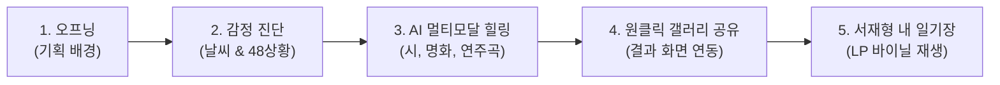

# 🌿 안단테(Andante) 서비스 최종 시연 시나리오

> **"느리게 걷는 당신의 템포에 맞춰, 마음을 돌보는 AI 감성 힐링 플랫폼"**  
> 본 시나리오는 평가위원, 교수진, 데모데이 청중을 대상으로 서비스의 기획 의도와 기술적 완성도를 가장 매끄럽게 전달할 수 있도록 구성된 **5~7분 표준 발표 대본 및 화면 조작 가이드**입니다.

---

## 📋 1. 시연 개요

| 항목 | 내용 |
| :--- | :--- |
| **발표 시간** | 총 5분 ~ 7분 (시연 4분 + Q&A 대비 2분) |
| **시연 페르소나** | 바쁜 일상과 마감 압박 속에 지친 20대 대학생/직장인 |
| **시연 핵심 흐름** | 로그인 ➔ 감정·상황 진단 ➔ AI 멀티모달 생성 (시·명화·순수연주 BGM) ➔ 전체화면 힐링 ➔ 갤러리 공유 ➔ 서재형 내 일기장 열람 |
| **핵심 차별화 포인트** | ① 48개 세부 생활감정 기반 즉각적 BGM 매칭 (음성/오디오북 필터링) ② 감정 팔레트와 동적 백드롭 테마 UI ③ 명화 캔버스와 서재형 아날로그 감성의 결합 |

---

## 🛠️ 2. 시연 전 사전 준비 체크리스트

1. **서버 및 터널링 상태 확인**:
   - `node server.js` 정상 실행 중 확인 (포트 3000)
   - ngrok 터널 활성화 상태 확인 (모바일 시연 또는 외부 접속용)
2. **시연용 계정 준비**:
   - 테스트용 계정 (예: `shin` 또는 사전에 작성된 일기가 2~3개 있는 시연용 계정)
3. **오디오 출력 환경**:
   - PC 스피커 볼륨 적정 수준(40~50%) 세팅 (Jamendo 연주곡이 명확히 들리도록 준비)
4. **브라우저 창 준비**:
   - 1440px 해상도 전체화면 권장 (헤더 로고 중앙 정렬 및 4열 갤러리 최적 뷰)
   - 캐시 충돌 방지를 위해 시크릿 창 또는 강력 새로고침(`Ctrl + F5`) 준비

---

## 🎬 3. 단계별 시연 흐름 (화면 조작 + 발표 대본)

---

### [Scene 1] 오프닝 & 서비스 소개 (소요 시간: 약 45초)

- **화면 위치**: 메인 홈 화면 (`/`) 또는 로그인 화면 (`/login.html`)
- **화면 조작**: 메인 랜딩 페이지를 시원하게 보여주며 시작

> **🎙️ 발표자 멘트**:  
> "안녕하세요. 느리게 걷는 당신의 템포에 맞춰 마음을 돌보는 AI 감성 일기 플랫폼, **안단테(Andante)** 발표를 시작하겠습니다.  
> 현대인들은 바쁜 일상 속에서 자신의 감정을 솔직하게 마주할 여유를 잃어가고 있습니다. 안단테는 음악의 빠르기말 '안단테(걸어가듯 천천히)'처럼, 하루를 마치는 사용자가 자신의 마음을 편안하게 털어놓고 감각적인 위로를 받을 수 있도록 기획되었습니다.  
> 지금부터 지친 하루 끝에 안단테를 통해 마음을 치유받는 과정을 직접 보여드리겠습니다."

---

### [Scene 2] 감정 진단 & 날씨·사연 입력 (소요 시간: 약 1분 15초)

- **화면 위치**: 메인 화면 Step 1 ➔ Step 2
- **화면 조작**:
  1. 감정 카테고리 6개 중 **[복잡한 생각 & 갈등]** 또는 **[지친 하루 & 쉼의 필요]** 클릭  
     *(카테고리 선택 시 배경 테마 색상 `--bg`이 파스텔톤으로 은은하게 변하는 인터랙션 강조)*
  2. 세부 상황 8개 중 **[마감 직전 벼락치기로 심장 뜀]** 클릭
  3. 현재 실시간 날씨 위젯 확인 (예: 맑음, 기온 표시)
  4. 에너지 배터리 슬라이더를 30% 정도로 조절
  5. 사연 입력창에 간단한 사연 입력 후 **[그림과 시 받기]** 버튼 클릭
     - *사연 예시: "프로젝트 마감이 코앞이라 심장이 너무 떨리고 불안해요. 밤새 준비했는데 실수 없이 잘 끝낼 수 있을지 걱정됩니다."*

> **🎙️ 발표자 멘트**:  
> "먼저 오늘 나의 기분을 마주하는 단계입니다. 안단테는 단순 긍·부정 이분법을 넘어 6가지 감정 영역과 48가지 생활 밀착형 세부 상황을 제공합니다.  
> '마감 직전 벼락치기로 심장 뜀'을 선택해 보겠습니다. 감정을 선택하는 즉시 화면의 감정 컬러 팔레트가 부드럽게 전환되며 심리적 안정감을 제공합니다.  
> 여기에 실시간 날씨 데이터와 감정 에너지 배터리를 결합하여 사용자의 상황을 다각도로 포착합니다. 사연을 적고 생성을 요청해 보겠습니다."

---

### [Scene 3] AI 멀티모달 힐링 생성 (소요 시간: 약 1분 45초)

- **화면 위치**: Step 3 (결과 화면)
- **화면 조작**:
  1. 로딩 프로그레스(호흡 애니메이션)가 완료되고 결과 화면 등장
  2. AI가 창작한 **위로의 시(Poem)**와 **캔버스 명화** 하이라이트
  3. 상단 **음악 스티커 플레이어** 주목:
     - 태그 확인: `#마감 직전 벼락치기로 심장 뜀` `#긴장 완화` `#BPM`
     - 음악 자동 재생 / 재생 버튼 클릭 (스피커로 맑은 연주곡 BGM 출력)
  4. **[힐링 모드 시작 (전체화면)]** 버튼 클릭 ➔ 몰입형 힐링 뷰 감상 ➔ `ESC`로 복귀

> **🎙️ 발표자 멘트**:  
> "결과 화면이 완성되었습니다. 안단테는 세 가지 감각으로 사용자에게 공감을 전합니다.  
> 첫째, 사연과 날씨를 은유적으로 녹여낸 **감성 위로 시**입니다.  
> 둘째, 감정의 톤을 시각화한 **16:9 와이드 AI 명화 캔버스**입니다.  
> 셋째, 청각적 치유를 위한 **BGM 큐레이션**입니다. 지금 재생되는 곡은 Jamendo API와 연동된 검증된 순수 연주곡(Instrumental)으로, 오디오북이나 낭독 등 방해 요소를 철저히 차단하고 상황에 맞춰 즉각 큐레이션되었습니다.  
> 특히 화면의 태그를 보시면, 과거 획일적인 문구가 아닌 사용자의 마감 상황에 맞춘 **'#긴장 완화'** 맞춤 태그가 정교하게 반영된 것을 확인하실 수 있습니다.  
> '힐링 모드' 버튼을 누르면 모든 군더더기를 없애고 오직 그림과 시, 음악에만 온전히 빠져들 수 있는 전체화면 모드가 실행됩니다."

---

### [Scene 4] 결과 화면 원클릭 갤러리 공유 (소요 시간: 약 1분)

- **화면 위치**: 결과 화면 액션 버튼 ➔ 공유 모달 ➔ 공유 갤러리 (`/board.html`)
- **화면 조작**:
  1. 결과 화면 하단의 **[🌐 갤러리 공유]** 버튼 클릭
  2. 모달 입력창에 제목 확인 (기본 시 제목 자동 채움) 후 **[확인]** 클릭
  3. 토스트 알림 확인: *"공유 갤러리에 등록되었습니다!"*
  4. 상단 메뉴의 **[공유 갤러리]** 메뉴 클릭하여 갤러리 이동
  5. 방금 공유한 카드가 4열 그리드 최상단에 테마 색상(`#FDFBD4` / 감정 파스텔)과 함께 등록된 모습 확인
  6. 카드 클릭하여 상세 모달 열기 ➔ LP 바이닐 회전과 음악 재생 시연

> **🎙️ 발표자 멘트**:  
> "이렇게 생성된 나만의 힐링 기록은 혼자 간직할 수도 있고, 다른 이들과 공감을 나눌 수도 있습니다.  
> 하단의 '갤러리 공유' 버튼을 누르고 제목을 확인한 뒤 등록해 보겠습니다.  
> 등록 완료 후 상단의 '공유 갤러리'로 이동하면, 방금 만든 작품이 데스크톱 4열 그리드에 감성적인 파스텔 카드로 즉시 반영됩니다.  
> 다른 사람의 글을 눌러보면 턴테이블 위 바이닐 LP가 부드럽게 회전하며 해당 게시글에 담긴 힐링 음악이 재생되고, 좋아요를 통해 익명의 따뜻한 연대감을 나눌 수 있습니다."

---

### [Scene 5] 서재형 내 일기장 아카이빙 (소요 시간: 약 1분)

- **화면 위치**: 상단 메뉴 **[일기장]** (`/?view=diary`)
- **화면 조작**:
  1. 상단 메뉴의 **[일기장]** 클릭
  2. 양장본 서가 스타일의 일기장 뷰로 즉시 전환
  3. 좌우 페이지를 넘기며 과거에 기록된 일기 목록 탐색
  4. 일기 하단 커스텀 바이닐 플레이어의 재생 버튼 클릭 ➔ 타임 바 이동 조작
  5. 차단된 음원이나 재생 불가 음원의 경우 *"지금은 재생할 수 없어요"*로 안전하게 예외 처리된 안내 문구 강조

> **🎙️ 발표자 멘트**:  
> "마지막으로 안단테의 핵심 보관소인 '내 일기장'입니다.  
> 안단테는 디지털 화면에서도 종이책의 질감과 아날로그 서재의 온도를 느낄 수 있도록 양장본 북 디자인을 적용했습니다.  
> 책장을 넘기듯 일기를 확인하고, 하단의 미니멀 바이닐 플레이어를 통해 언제든 그날의 감정과 음악을 다시 꺼내 들을 수 있습니다.  
> 만약 저작권이나 서비스 사정으로 재생이 어려운 음원이 있더라도 화면이 깨지지 않고 '지금은 재생할 수 없어요'라는 정제된 안내를 제공하는 등 안정성도 세심하게 확보했습니다."

---

### [Scene 6] 클로징 및 기술 스택 요약 (소요 시간: 약 30초)

- **화면 위치**: 일기장 서가 화면 또는 홈 화면
- **화면 조작**: 화면을 차분히 보여주며 청중을 응시

> **🎙️ 발표자 멘트**:  
> "안단테는 프론트엔드의 세련된 반응형 에디토리얼 글래스모피즘 UI와, 백엔드의 Node.js BFF 아키텍처, Oracle Cloud DB, Google Gemini 생성형 AI, 그리고 Jamendo 음악 추천 파이프라인이 유기적으로 맞물려 완성된 감성 테크 플랫폼입니다.  
> 앞으로도 지친 현대인들이 잠시 걸음을 멈추고 자신만의 호흡을 되찾을 수 있는 따뜻한 쉼터가 되겠습니다.  
> 경청해 주셔서 감사합니다. 질문 있으시면 답변드리겠습니다."

---

## 💡 4. 심사위원 / 평가자 단골 질문 & 모범 답변 (Q&A 대비)

> [!TIP]
> 발표 후 질의응답 시 아래 4가지 질문이 가장 자주 나옵니다. 핵심 키워드를 중심으로 자신감 있게 답변하세요.

#### Q1. "기존 일기 앱이나 감정 챗봇과 비교했을 때 안단테만의 차별점은 무엇인가요?"
> **답변**: "단순히 텍스트를 기록하거나 텍스트로만 대답하는 챗봇과 달리, 안단테는 **'시(문학) + 명화(시각) + 연주곡(청각)'이 결합된 멀티모달 공감 플랫폼**이라는 점입니다. 특히 날씨와 에너지 수준, 48가지 세부 상황을 종합 진단하여 사용자 감정 상태에 맞는 템포(BPM)의 연주곡을 즉시 매칭해 실질적인 이완과 힐링 효과를 줍니다."

#### Q2. "음악 추천에서 왜 가요나 보컬 곡 대신 연주곡(Instrumental)만 고집하나요?"
> **답변**: "심리학적으로 가사가 있는 노래나 팟캐스트, 오디오북 같은 음성 콘텐츠는 글을 읽고 감정을 정리하는 사용자의 인지적 주의력을 분산시킵니다. 안단테는 사용자가 자신의 마음에 온전히 몰입할 수 있도록 Jamendo API의 `vocalinstrumental=instrumental` 파라미터와 13가지 음성 키워드 2차 필터링을 통해 순수 악기 연주곡만을 엄선하여 제공하고 있습니다."

#### Q3. "외부 Jamendo API 호출 속도가 느리거나 실패할 위험은 어떻게 해결했나요?"
> **답변**: "서버 기동 시 48개 감정 상황에 대한 음원을 사전에 비동기 웜업(Warmup)하여 캐싱해 둡니다. 따라서 사용자가 시연하거나 접속할 때 외부 API 딜레이 없이 0.1초 만에 즉각 음악을 로드할 수 있으며, 호출 실패 시에도 동일 카테고리 대체 곡 fallback 로직이 구축되어 있어 무중단 서비스를 보장합니다."

#### Q4. "개인정보나 계정 보안은 어떻게 신경 썼나요?"
> **답변**: "JWT 기반 토큰 인증과 bcrypt 비밀번호 단방향 해싱 암호화를 적용했습니다. 또한 신규 가입 및 변경 시 8자리 이상 복합 규칙과 실시간 아이디 중복 검사를 거치며, 인증 실패 시 아이디/비밀번호 존재 여부를 분리 노출하지 않는 보안 표준을 준수하고 있습니다."
